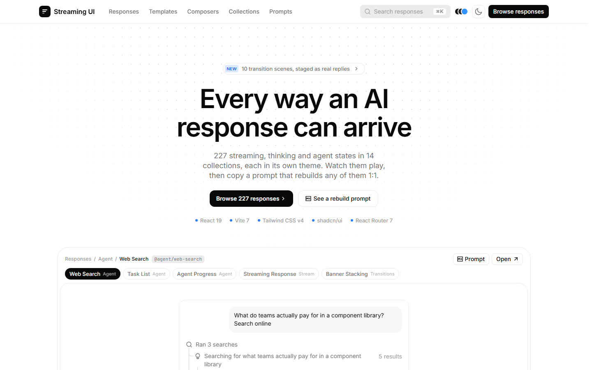
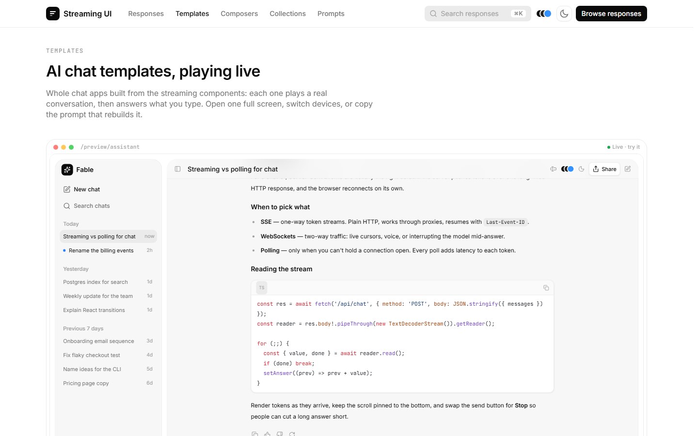
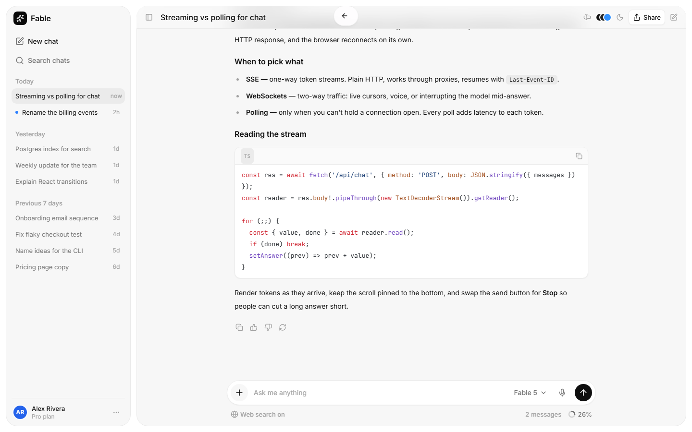

<div align="center">

# Streaming UI

**Every way an AI response can arrive.**

249 live streaming, thinking and agent patterns · 10 complete AI chat templates · 11 composers you can install with the shadcn CLI.

[](https://react.dev)
[](https://vite.dev)
[](https://tailwindcss.com)
[](https://ui.shadcn.com/docs/registry)
[](https://www.typescriptlang.org)
[](LICENSE)



</div>

## Contents

- [Features](#features)
- [Quick start](#quick-start)
- [Install a composer in your project](#install-a-composer-in-your-project)
- [What's inside](#whats-inside)
- [Project structure](#project-structure)
- [Scripts](#scripts)
- [How it works](#how-it-works)
- [Contributing](#contributing)
- [Credits and license](#credits-and-license)

## Features

- **249 response patterns, playing live.** Reasoning blocks, shimmering status lines, tool calls, web search trails, task lists, skeletons, dot-grid loaders, approval cards and full agent timelines, sorted into 14 collections. Every card plays on screen and stops off screen.
- **A rebuild prompt for everything.** Each demo, template and composer opens a Markdown prompt with the exact choreography, timings and source files, ready to paste into an AI coding assistant.
- **10 AI chat templates.** Assistant, Research, Coding Agent, Support Copilot, Data Analyst, Agent Builder, Canvas, Deep Research, Agent Approvals and Model Compare. Each one plays a scripted conversation, then answers what you type, with a desktop / tablet / mobile preview.
- **11 interchangeable composers.** Pill, Box, Panel, Dock, Command, Inline, Voice, Halo, Media, Palette and Mention, all behind one `<Composer variant="…" />` API. Pick one for every template at once from any header.
- **A shadcn registry.** Every composer, the shared kit, the model picker and the design tokens install into your own project with one `bunx shadcn add` command.
- **Light and dark, four palettes.** Graphite, Dusk, Slate and Sand swap the neutral and accent scales of the whole UI; the choice follows into every live preview.
- **Built for real use.** Real dictation (Web Speech API, with a fallback), attachments with upload rings, a model picker with effort levels and fast mode, a context ring with usage limits, keyboard support everywhere.

<table>
  <tr>
    <td width="50%"></td>
    <td width="50%"></td>
  </tr>
  <tr>
    <td align="center"><sub>Chat templates, each thumbnail is the live app</sub></td>
    <td align="center"><sub>The Assistant template, full window</sub></td>
  </tr>
</table>

## Quick start

Requires [Bun](https://bun.sh) 1.3 or later.

```bash
git clone https://github.com/MakFly/streaming-ui.git
cd streaming-ui
bun install
bun run dev
```

Open <http://localhost:5173>.

## Install a composer in your project

The composers are published as a [shadcn registry](https://ui.shadcn.com/docs/registry) from `public/r/`. In any project set up with shadcn (React + Tailwind CSS v4):

```bash
# one composer, with the kit and tokens it needs
bunx shadcn@latest add https://streaming-ui.pulseview.app/r/composer-pill.json

# all eleven behind one <Composer variant="…" /> switch
bunx shadcn@latest add https://streaming-ui.pulseview.app/r/composer.json
```

Then import the tokens once in your global CSS, after Tailwind:

```css
@import "tailwindcss";
@import "./styles/streaming-ui.css";
```

And use it:

```tsx
import { useState } from 'react';
import { PillComposer } from '@/components/composer/variants/pill';

export function Chat() {
  const [draft, setDraft] = useState('');
  return <PillComposer value={draft} onChange={setDraft} onSend={(text) => { /* send */ setDraft(''); }} context={42} />;
}
```

The registry items point at each other by URL. `bun run registry:build` builds them for <https://streaming-ui.pulseview.app>; for another deployment, set the address yourself (the script refuses to run without one):

```bash
REGISTRY_URL=https://your-site.example bun scripts/build-registry.mjs
```

| Item | What you get |
| --- | --- |
| `composer-pill` … `composer-mention` | One composer each (`PillComposer`, `BoxComposer`, …), standalone |
| `composer` | All eleven behind `<Composer variant="…" />`, plus the provider that swaps them everywhere |
| `composer-kit` | The shared props contract, field behaviour, buttons, dictation, status line, context ring, attachments |
| `composer-theme` | The design tokens as one stylesheet (`styles/streaming-ui.css`) |
| `model-picker` | Providers, effort slider with the Max effect, fast mode |

## Install the thinking orbs

The thinking orbs are by [Jakub Antalik](https://x.com/jakubantalik), made with help from [Alexandr Brinza](https://x.com/a_brinza): see [libraries.dev/orbs](https://libraries.dev/orbs) and the MIT package [thinking-orbs](https://github.com/Jakubantalik/Libraries.dev/tree/main/packages/thinking-orbs). Streaming UI redistributes the engine with its license and a credit header in every file, and adds the status pill and chip of the showcase. No tokens or CSS to import.

```bash
# the orb: nine states, sizes 64, 32 and 20
bunx shadcn@latest add https://streaming-ui.pulseview.app/r/thinking-orb.json

# the orb with its shimmering label, as a pill or a chip
bunx shadcn@latest add https://streaming-ui.pulseview.app/r/orb-status.json
```

```tsx
import { ThinkingOrb } from '@/components/thinking-orb';
import { OrbStatus } from '@/components/thinking-orb/orb-status';

<ThinkingOrb state="searching" size={64} />
<OrbStatus state="solving" label="Solving…" variant="pill" />
```

## What's inside

| Route | Page |
| --- | --- |
| `/` | Landing page: live showcase, collections, catalogue, prompts, an interactive composer |
| `/responses` | The gallery, every collection (`?q=` search, `?view=list`) |
| `/responses/library/:collection` | One collection, e.g. `/responses/library/agent` |
| `/demo/:slug` | One response on its own page |
| `/templates` | The 10 chat templates, each thumbnail live |
| `/templates/:slug` | Template page: preview or code, device switcher, live preview, copy prompt |
| `/composers` | The 11 composers, each in its own live thread, with spec, comparison, Prompt and Install |
| `/orbs` | The thinking-orb loaders: all nine states, then a playground (state, size, play/pause) with its snippet |
| `/preview/:slug` | A bare template, full window (what the previews load) |

Every page with a Prompt has a matching `…/prompt` URL that opens it directly.

## Project structure

```
src/
  main.tsx                 providers (theme + palette, playback, tooltips) + router
  router.tsx               route tree, each page lazy-loaded and prefetched while idle
  routes/                  landing, gallery, demo, templates, template, composers, orbs, preview, prompt, 404
  components/              site chrome, demo stage, prompt dialog, palette picker, install button, shadcn ui/
  engine/                  the 249 response demos (imperative DOM choreographies) and their registry
  templates/               the 10 chat templates
    kit/                   the chat kit: engine, markdown, parts, model picker, attachments, limits
      composer-kit.tsx     props contract and shared composer behaviour
      composers.tsx        <Composer variant="…" /> switch
      variants/            one file per composer (+ *.showcase.tsx for the /composers page)
  styles/                  theme, typography, palettes, globals, scrollbars, per-collection scopes
public/
  r/                       the built shadcn registry (bun run registry:build)
  sources/                 original registry sources, used to build the demo prompts
scripts/                   build-registry.mjs, collect-classes.mjs
```

## Scripts

| Command | Does |
| --- | --- |
| `bun run dev` | Dev server on <http://localhost:5173> |
| `bun run build` | Typecheck, then production build in `dist/` |
| `bun run preview` | Serve `dist/` |
| `bun run typecheck` | `tsc -b` only |
| `bun run registry:build` | Write `registry.json`, bundle the tokens, run `shadcn build` into `public/r/` |
| `bun run registry:check` | Rebuild the registry and fail if `public/r/` differs from what is committed |

## How it works

- **Demos.** Each of the 249 demos follows one contract, `{ group, title, desc, kind, run(root, t, ctx) }`. React owns the stage element; the demo owns what is inside it. `t` is a timer scope, so clearing it stops everything a demo scheduled.
- **Prompts.** A demo's prompt is rebuilt from `run.toString()` and the helpers it uses, so the production build keeps the code as authored: no minification, `esnext` target, no tree-shaking (see `vite.config.ts`).
- **Templates.** `templates/kit/engine.ts` runs async scripts (think, call tools, stream markdown, ask for approval) as React state. A new message or Stop cancels whatever is playing.
- **Theme and palettes.** Dark mode is a `.dark` class on `<html>`; a palette is a `data-palette` attribute that swaps the `--color-neutral-*` and `--color-accent-*` scales every semantic token is built from. Both are applied before first paint and synced across tabs and preview frames.
- **Performance.** Pages are code-split and prefetched when the browser is idle; template thumbnails boot two at a time behind a skeleton.

## Contributing

Issues and pull requests are welcome.

1. Fork the repository and create a branch.
2. `bun install`, then `bun run dev`.
3. Keep `bun run build` passing (it typechecks first).
4. New composer: add `src/templates/kit/variants/<id>.tsx` (+ `<id>.showcase.tsx`), register it in `variants/index.ts` and `composer-variant.tsx`, then run `bun run registry:build`.
5. New template: add `src/templates/<name>.tsx` with a default export and register it in `src/templates/registry.ts`.

## Credits and license

Streaming UI is released under the [MIT License](LICENSE).

Parts of the code are adapted from open-source projects, each under its own license. Their notices are kept in [THIRD_PARTY_NOTICES.md](THIRD_PARTY_NOTICES.md).

Fourteen Agent demos (`src/engine/packs/x-clones.js`) rebuild or adapt components first shown on X, with their authors' permission; each demo credits its author and post in its description and rebuild prompt: [@eliakuratli](https://x.com/eliakuratli/status/2113618712066711970), [@jeetnirnejak](https://x.com/jeetnirnejak/status/2095507715556831429), [@a1x45h](https://x.com/a1x45h/status/2112964394825187349) (two), [@pitus_](https://x.com/pitus_/status/2111519352503873866) (two), [@kvnkld](https://x.com/kvnkld/status/2089693820313366635), [@louisnstudio](https://x.com/louisnstudio/status/2096525796714438833) (with the window layout of [@startupvisuals](https://x.com/startupvisuals/status/2100519773914427610)), [@bobganiev](https://x.com/bobganiev/status/2106396667398533125) (on ReUI's MIT stepper), [@itschatto](https://x.com/itschatto/status/2096962716036472894), [@PostiauxCharles](https://x.com/PostiauxCharles/status/2109606436527366235), [@sinequanonh](https://x.com/sinequanonh/status/2108225806954799155) and [@disarto_max](https://x.com/disarto_max/status/2100625465937424873) (two: a window and a widget, both drawn with the app's chat parts).
